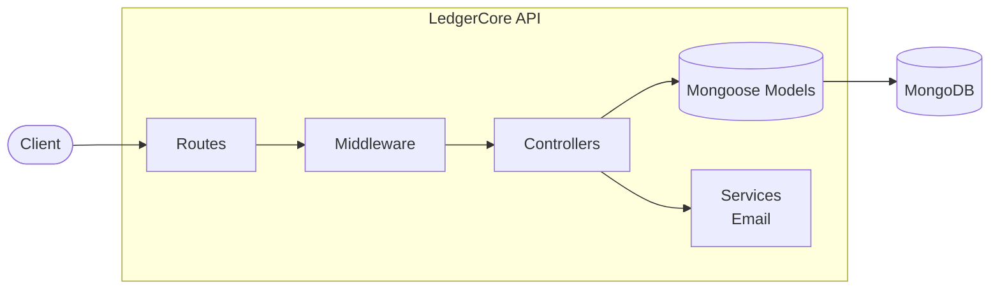

<div align="center">

# 🏦 LedgerCore

**A modular backend for account management and ledger-based financial transactions.**


[Live Demo](https://ledgercore-giq1.onrender.com)

</div>

---

## 📌 About the Project

**LedgerCore** is a RESTful backend service that models the core workflows of a banking-style application: user authentication, account management, and financial transactions recorded in a ledger.

The project follows a layered architecture (routes → controllers → models → services) so each concern is isolated, easy to test, and easy to extend. It is built as a foundation for ledger-oriented systems where **correctness, traceability, and security** matter.

---

## ✨ Key Features

- **Authentication** — user registration and login with JWT and cookie-based sessions.
- **Token blacklisting** — a dedicated blacklist model to invalidate tokens (e.g. on logout).
- **Account management** — create and manage user accounts through a dedicated API module.
- **Transaction processing** — transaction workflows backed by a separate transaction model.
- **Ledger model** — a dedicated ledger collection to keep a record of financial entries.
- **Email service** — a standalone service layer for sending email notifications.
- **Modular architecture** — config, controllers, middleware, models, routes, and services are cleanly separated.
- **Health check** — root endpoint confirms the service is running.

---

## 🛠 Tech Stack

| Layer          | Technology                     |
| -------------- | ------------------------------ |
| Runtime        | Node.js                        |
| Framework      | Express.js                     |
| Database       | MongoDB                        |
| ODM            | Mongoose                       |
| Authentication | JSON Web Tokens (JWT), cookies |
| Middleware     | `express.json()`, `cookie-parser` |
| API Style      | REST                           |

---

## 🧱 Architecture



**Request flow:** a request hits a route, passes through middleware (e.g. authentication), is handled by a controller, which interacts with Mongoose models and services before returning a JSON response.

---

## 📂 Project Structure

```text
LedgerCore/
├── src/
│   ├── config/
│   │   └── db.js                    # MongoDB connection
│   ├── controllers/
│   │   ├── account.controller.js
│   │   ├── auth.controller.js
│   │   └── transaction.controller.js
│   ├── middleware/                  # Auth and other request middleware
│   ├── models/
│   │   ├── account.model.js
│   │   ├── blackList.model.js       # Invalidated tokens
│   │   ├── ledger.model.js
│   │   ├── transaction.model.js
│   │   └── user.model.js
│   ├── routes/
│   │   ├── account.router.js
│   │   ├── auth.routes.js
│   │   └── transaction.route.js
│   ├── services/
│   │   └── email.service.js         # Email notifications
│   └── app.js                       # Express app setup and route mounting
├── .env                             # Environment variables (not committed)
├── package.json
└── README.md
```

---

## 🚀 Getting Started

### Prerequisites

- [Node.js](https://nodejs.org/) (current LTS recommended)
- npm
- A MongoDB instance (local or [MongoDB Atlas](https://www.mongodb.com/atlas))

### Installation

1. **Clone the repository**

   ```bash
   git clone https://github.com/iiitianrajan/LedgerCore
   cd LedgerCore
   ```

2. **Install dependencies**

   ```bash
   npm install
   ```

3. **Configure environment variables**

   Create a `.env` file in the project root (see [Environment Variables](#-environment-variables)).

4. **Start the server**

   ```bash
   # Production
   npm start

   # Development (if a dev script is configured, e.g. with nodemon)
   npm run dev
   ```

5. **Verify it's running**

   ```bash
   curl http://localhost:5000/
   ```

   Expected response:

   ```text
   LedgerCore Service is up and running
   ```

---

## 🔐 Environment Variables

Create a `.env` file in the project root:

```env
PORT=5000
MONGODB_URI=replace_wiht_mongodb_connection_string
JWT_SECRET=replace_with_a_strong_random_secret

# Email service (adjust to match your email.service.js)
EMAIL_USER=your_email@example.com
EMAIL_PASS=your_app_password
```

> ⚠️ Never commit `.env` or real credentials. Make sure `.env` is listed in `.gitignore`.

---

## 📡 API Overview

| Base Path            | Description                          |
| -------------------- | ------------------------------------ |
| `GET /`              | Health check                         |
| `/api/auth`          | Registration, login, and logout      |
| `/api/accounts`      | Account creation and management      |
| `/api/transactions`  | Create and manage transactions       |

<details>
<summary><b>Example: health check</b></summary>

```bash
curl http://localhost:5000/
```

</details>

> 📝 A detailed endpoint-by-endpoint reference (methods, payloads, responses) will be added as the API contract is finalized. Planned: OpenAPI/Swagger documentation.

---

## 🧭 Design Principles

- **Separation of concerns** — routing, business logic, data access, and external services live in separate layers.
- **Ledger-oriented thinking** — transactions and ledger entries are modelled as distinct records so financial activity can be traced.
- **Extensibility** — new modules (e.g. cards, statements, notifications) can be added without touching existing ones.
- **Security by default** — secrets in environment variables, token invalidation support, and cookie-based credentials.

---

## 🛡 Security Considerations

Before deploying to production:

- Store secrets in environment variables or a managed secrets service.
- Serve the API over HTTPS and use `httpOnly`, `secure`, and `sameSite` cookie flags.
- Validate and sanitize all request data.
- Apply authentication and authorization to every protected route.
- Add rate limiting and consistent error handling.
- Never log passwords, tokens, or other credentials.
- Configure CORS explicitly for browser-based clients.
- Use least-privilege database credentials and keep backups.
- For money movement, use MongoDB multi-document transactions, idempotency keys, and concurrency controls so balances stay consistent.

---

## 🗺 Roadmap

- [ ] Complete API documentation (OpenAPI/Swagger)
- [ ] Request validation and centralized error handling
- [ ] Unit and integration tests
- [ ] Atomic transfers using MongoDB sessions/transactions
- [ ] Idempotency keys for retry-safe transaction requests
- [ ] Immutable ledger entries and reconciliation checks
- [ ] Rate limiting and structured logging
- [ ] CI/CD pipeline and Docker support

---

## 🤝 Contributing

Contributions are welcome!

1. Fork the repository
2. Create a feature branch: `git checkout -b feature/your-feature`
3. Commit your changes: `git commit -m "Add your feature"`
4. Push to the branch: `git push origin feature/your-feature`
5. Open a Pull Request with a clear description

---

## 📄 License

Distributed under the MIT License.

---

## 👤 Author

**Rajan Kumar**

- GitHub: ([iiitianrajan](https://github.com/iiitianrajan/LedgerCore))


<div align="center">

⭐ If you found this project useful, consider giving it a star!

</div>
